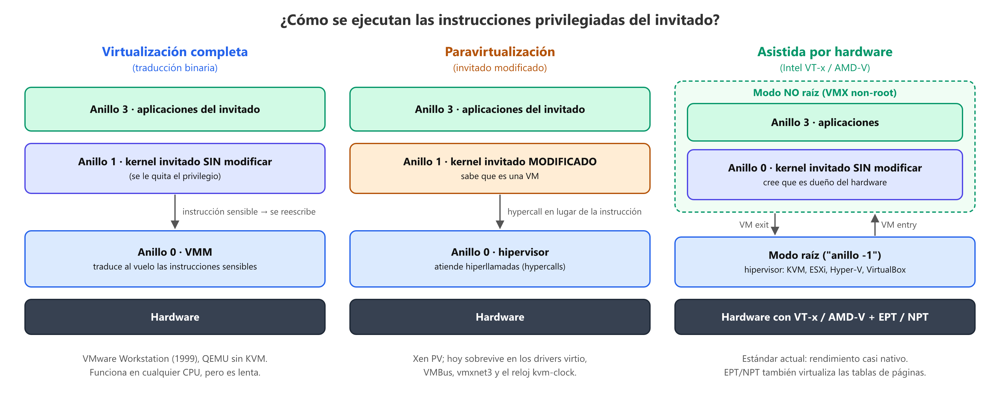
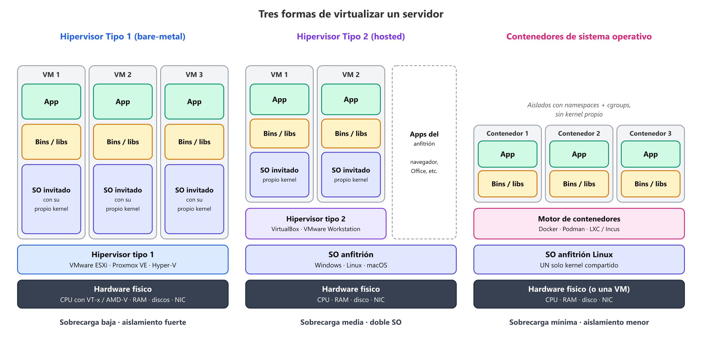
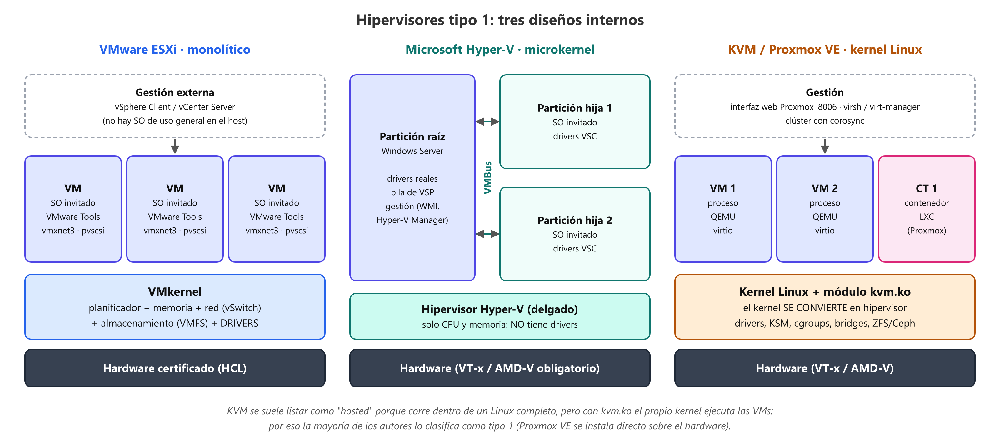
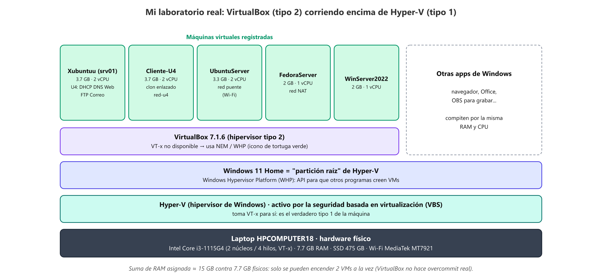
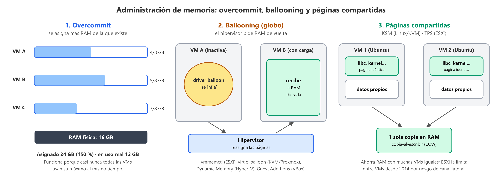
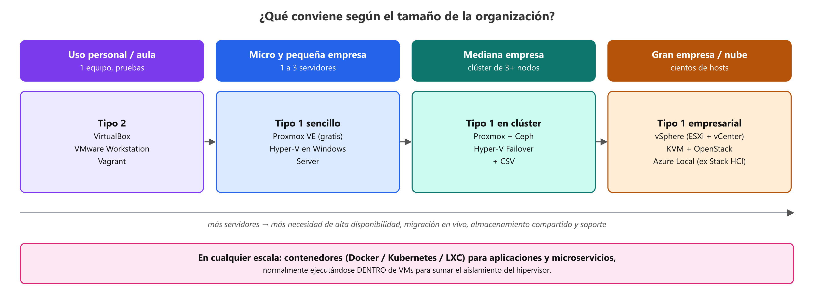

# Tarea 5.1 — Estudio analítico de arquitecturas de virtualización e hipervisores

**Materia:** Administración de Servidores · **Unidad 5: Virtualización**
**Alumno:** Josué Javier Álvarez Valle · ITS Monclova
**Laboratorio de referencia:** Windows 11 Home + VirtualBox 7.1.6 · Intel Core i3-1115G4 · 7.7 GB RAM

Este documento explica qué es la virtualización, clasifica los hipervisores en **Tipo 1 (bare-metal)**, **Tipo 2 (hosted)** y **contenedores de sistema operativo**, y los compara en cuatro aspectos técnicos: **sobrecarga (overhead), administración de memoria, almacenamiento compartido y rendimiento de red**. Al final se indica qué opción conviene según el tamaño de la organización.

| Contenido | Archivo |
|---|---|
| Marco analítico y tabla comparativa | este README |
| Diagramas de arquitectura (PNG) | [docs/img/](docs/img/) |
| Script que detecta la virtualización desde dentro de una VM Linux | [scripts/detectar_virtualizacion.sh](scripts/detectar_virtualizacion.sh) |
| Script que describe el anfitrión Windows y su hipervisor | [scripts/info_anfitrion.ps1](scripts/info_anfitrion.ps1) |
| Salidas de los scripts | [evidencias/](evidencias/) |
| Guion del video | [docs/guion_video.md](docs/guion_video.md) |

---

## 1. Principios de la virtualización

**Virtualizar** es crear, con software, una versión "lógica" de un recurso físico: CPU, memoria, disco o red. Una **máquina virtual (VM)** es un equipo completo hecho de recursos virtuales (vCPU, vRAM, disco virtual, tarjeta de red virtual) que ejecuta su propio sistema operativo. La pieza que reparte el hardware real entre las VMs y las mantiene aisladas es el **hipervisor** o **VMM** (*Virtual Machine Monitor*).

### 1.1 Requisitos de Popek y Goldberg (1974)

Un hipervisor correcto debe cumplir tres propiedades:

| Propiedad | Significado |
|---|---|
| **Equivalencia** | Un programa se comporta igual dentro de la VM que en hardware real. |
| **Control de recursos** | El hipervisor tiene el control total: una VM no puede tomar recursos que no se le asignaron. |
| **Eficiencia** | La mayoría de las instrucciones corren directo en la CPU, sin que el hipervisor intervenga. |

La arquitectura x86 original no cumplía la tercera: tenía instrucciones "sensibles" que no generaban una trampa (*trap*) al ejecutarse sin privilegios. Para resolverlo surgieron tres técnicas:



| Técnica | Cómo funciona | Ejemplos | Situación actual |
|---|---|---|---|
| **Virtualización completa por traducción binaria** | El VMM revisa el código del kernel invitado y reescribe al vuelo las instrucciones sensibles. El invitado no se modifica. | VMware Workstation (1999), QEMU sin KVM (TCG) | Solo se usa cuando la CPU no tiene VT-x/AMD-V. Es lenta. |
| **Paravirtualización** | El kernel invitado se modifica para pedir servicios al hipervisor con *hypercalls*. | Xen PV | Hoy se aplica sobre todo a **drivers**: virtio, VMBus, vmxnet3, el reloj kvm-clock. |
| **Asistida por hardware** | La CPU agrega un modo "raíz" (anillo −1) para el hipervisor. El invitado corre sin modificar en modo no-raíz; las instrucciones sensibles provocan un *VM exit*. EPT/NPT virtualizan también las tablas de páginas. | Intel VT-x + EPT, AMD-V + NPT | **Estándar actual**: lo usan KVM, ESXi, Hyper-V y VirtualBox. |

### 1.2 Recursos que se virtualizan

| Recurso | Cómo lo entrega el hipervisor |
|---|---|
| **CPU** | vCPU = hilos que el planificador del hipervisor asigna a núcleos físicos. Se pueden asignar más vCPU que núcleos reales (sobresuscripción). |
| **Memoria** | Cada VM ve una RAM "física" propia. El hipervisor la traduce a RAM real (EPT/NPT) y puede reclamarla o compartirla (sección 3.2). |
| **Disco** | Archivos (VDI, VMDK, VHDX, qcow2) o volúmenes (LVM, ZFS, Ceph RBD, LUN iSCSI). Pueden ser de tamaño fijo o **dinámicos (thin provisioning)**. |
| **Red** | Tarjetas virtuales (e1000, virtio-net, vmxnet3, NIC sintética) conectadas a **switches virtuales**: bridge, NAT, red interna, host-only. |

---

## 2. Clasificación



### 2.1 Hipervisor Tipo 1 (bare-metal o nativo)

Se instala **directamente sobre el hardware**: no hay un sistema operativo de uso general debajo. Es la base de los centros de datos y de la nube.



| Producto | Diseño | Características principales |
|---|---|---|
| **VMware ESXi** (Broadcom) | Monolítico: el VMkernel incluye los drivers. | Muy maduro. Se gestiona con vCenter: vMotion (migración en vivo), DRS (balanceo), HA, vSAN. Solo funciona con hardware certificado (HCL). Desde 2024 se licencia por suscripción (VMware vSphere Foundation / VCF); la edición gratuita es limitada. |
| **Proxmox VE** | Debian + kernel Linux con **KVM** + contenedores **LXC**. | Código abierto y gratuito (el soporte es de pago). Interfaz web en el puerto 8006, clúster con corosync, HA, almacenamiento ZFS y Ceph integrado, copias con Proxmox Backup Server. |
| **Microsoft Hyper-V** | Microkernel: el hipervisor es delgado y los drivers viven en la **partición raíz** (Windows). | Rol de Windows Server 2022/2025. El último Hyper-V Server gratuito independiente fue la versión 2019. Dynamic Memory, Live Migration, réplicas, clúster de conmutación con Cluster Shared Volumes. También está presente en Windows 10/11 (Pro) y por debajo de WSL2 y de la seguridad basada en virtualización (VBS). |

**Ventajas:** menor sobrecarga, mejor aislamiento (menos superficie de ataque), funciones empresariales (alta disponibilidad, migración en vivo, almacenamiento compartido).
**Desventajas:** necesitan un equipo dedicado, los productos comerciales cuestan, y se administran por red, no "en la misma PC".

### 2.2 Hipervisor Tipo 2 (hosted o alojado)

Es un **programa** que se instala sobre un sistema operativo anfitrión (Windows, Linux o macOS). Para llegar al hardware depende del kernel del anfitrión.

| Producto | Características principales |
|---|---|
| **Oracle VirtualBox** | Gratis y multiplataforma. VMs en archivos `.vbox` + `.vdi`. Redes NAT, puente, red interna, host-only y red NAT. Instantáneas, clones enlazados, exportación OVA, automatización con `VBoxManage` y Vagrant. |
| **VMware Workstation Pro** (antes también *Player*) | Desde 2024 es gratuito para uso personal y comercial. Rendimiento gráfico superior, redes `vmnet` configurables, clones y snapshots. Player se integró en Workstation. |
| **KVM/QEMU** en un Linux de escritorio | QEMU emula el hardware y KVM acelera con VT-x. Se gestiona con libvirt (`virsh`, virt-manager). Las guías lo listan como "hosted" porque corre sobre un Linux completo, pero técnicamente el módulo `kvm.ko` convierte al kernel en hipervisor: por eso muchos autores lo clasifican como **tipo 1** (es la base de Proxmox, OpenStack y Google Cloud). |

**Ventajas:** fácil de instalar en cualquier PC, ideal para aprender, desarrollar y probar; se puede usar la PC para otras tareas al mismo tiempo.
**Desventajas:** doble sistema operativo (más sobrecarga), compite por RAM y CPU con las aplicaciones del anfitrión, sin alta disponibilidad ni almacenamiento compartido real, y un fallo del anfitrión tumba todas las VMs.

### 2.3 Contenedores de sistema operativo

No virtualizan hardware: **aíslan procesos** dentro del mismo kernel Linux usando **namespaces** (cada contenedor ve sus propios procesos, red, usuarios y sistema de archivos) y **cgroups** (límites de CPU, RAM y E/S).

| Tipo | Ejemplos | Uso |
|---|---|---|
| **Contenedor de sistema** | LXC / Incus, contenedores de Proxmox, OpenVZ | Se comporta como una "VM ligera" con init y varios servicios. |
| **Contenedor de aplicación** | Docker, Podman, orquestados con Kubernetes | Un proceso o servicio por contenedor; imágenes inmutables; microservicios y CI/CD. |

**Ventajas:** arrancan en segundos, sobrecarga casi nula y mucha densidad (decenas o cientos por servidor).
**Desventajas:** comparten el kernel, así que un contenedor Linux no puede ejecutar Windows, y una falla del kernel afecta a todos. El aislamiento es menor que el de una VM, por eso en producción se suelen ejecutar **dentro de VMs**.

### 2.4 Caso real: mi laboratorio es un tipo 2 encima de un tipo 1

El script [`info_anfitrion.ps1`](scripts/info_anfitrion.ps1) mostró que en mi laptop **Hyper-V ya está activo**, porque Windows 11 usa la **seguridad basada en virtualización (VBS)**. Hyper-V toma VT-x, y Windows pasa a ser su "partición raíz". VirtualBox no puede usar VT-x directamente. En su registro aparece `HMR3Init: Attempting fall back to NEM: VT-x is not available`: VirtualBox ejecuta las VMs a través de la API **Windows Hypervisor Platform (NEM)**, y en la barra de estado de la VM se ve una tortuga verde.



Consecuencias prácticas:

- Las VMs funcionan, pero un poco más lentas que con VT-x directo.
- **No hay virtualización anidada**: dentro de una VM de VirtualBox no se puede usar KVM con aceleración. El script `detectar_virtualizacion.sh` lo confirma: dentro de la VM no aparecen las banderas `vmx`/`svm`.
- La RAM asignada a todas mis VMs suma unos 15 GB contra 7.7 GB físicos. VirtualBox no hace overcommit real, así que en la práctica solo puedo encender dos VMs a la vez.

---

## 3. Tabla comparativa técnica

### 3.1 Comparativa por plataforma

> Los porcentajes de sobrecarga son **referencias aproximadas** (dependen del tipo de carga, de los drivers paravirtualizados y del hardware). Sirven para comparar plataformas entre sí, no como medida exacta.

| Plataforma | Tipo | Sobrecarga de hardware (overhead) | Administración de memoria (overcommit / ballooning) | Almacenamiento compartido | Rendimiento de red |
|---|---|---|---|---|---|
| **VMware ESXi** | 1 | **Muy baja** (≈2–5 % CPU). Kernel mínimo dedicado; vmxnet3 y PVSCSI paravirtualizados. | **La más completa:** overcommit, ballooning (`vmmemctl` en VMware Tools), compresión de memoria, TPS (por defecto solo dentro de cada VM desde 2014) y swap del hipervisor. | **Excelente:** VMFS en clúster sobre SAN (FC, iSCSI), NFS, vSAN, vVols. Permite vMotion y HA. | **Muy alto:** vSwitch estándar y distribuido, NIC vmxnet3, SR-IOV, NIOC (calidad de servicio). |
| **Proxmox VE** (KVM + LXC) | 1 | **Muy baja** (≈2–5 % en VM con virtio; ≈0–1 % en LXC). | **Completa:** overcommit de Linux, **virtio-balloon** (ballooning automático), **KSM** (páginas compartidas); LXC con límites de cgroups. | **Excelente:** Ceph RBD integrado, NFS, iSCSI, ZFS (y ZFS over iSCSI), LVM compartido, CIFS. Migración en vivo y HA. | **Muy alto:** bridges de Linux u Open vSwitch, VLAN, SDN, virtio-net con vhost-net, SR-IOV. |
| **Microsoft Hyper-V** | 1 (microkernel) | **Baja** (≈3–6 %). La partición raíz Windows consume algo de RAM y CPU. | **Buena:** **Dynamic Memory** (mínimo / inicio / máximo + búfer) con balloon en los servicios de integración, Smart Paging al reiniciar. No comparte páginas (sin TPS/KSM). | **Excelente:** **Cluster Shared Volumes (CSV)**, SMB 3.0 (Scale-Out File Server), Storage Spaces Direct, iSCSI/FC. Live Migration. | **Muy alto:** Hyper-V Virtual Switch (externo / interno / privado), NIC sintética por VMBus, SR-IOV, VMQ y RSS. |
| **VirtualBox** | 2 | **Media** (≈5–15 %). Doble SO; mayor si corre sobre Hyper-V (modo NEM, como en mi laptop). | **Limitada:** la RAM se reserva al encender la VM y no hay overcommit real. Ballooning **manual** con Guest Additions (`VBoxManage controlvm ... guestmemoryballoon`). | **Básica:** sin clúster. Discos en un NAS, discos iSCSI, carpetas compartidas anfitrión↔invitado y discos "multiconexión". Sin migración en vivo entre anfitriones (*teleporting* es experimental). | **Media:** NAT en espacio de usuario (el más lento); puente, red interna y host-only con buen rendimiento; NIC virtio-net disponible. |
| **VMware Workstation Pro** | 2 | **Media-baja** (≈5–10 %). Monitor muy optimizado y buena aceleración 3D. | **Limitada:** ajuste de cuánta RAM del anfitrión se reserva; puede usar el swap del anfitrión; balloon con VMware Tools. Sin overcommit de producción. | **Básica:** carpetas compartidas y discos en red; sin almacenamiento en clúster. | **Media-alta:** redes `vmnet` (puente, NAT, host-only y personalizadas) con el editor de red virtual; vmxnet3. |
| **KVM/QEMU + libvirt** (en un Linux) | 1/2* | **Baja** (≈2–5 % con virtio). Sin VT-x (QEMU TCG) es muy alta. | **Completa:** overcommit de Linux, virtio-balloon, KSM, *free page reporting* y hugepages. | **Muy buena:** pools de libvirt sobre NFS, iSCSI, Ceph RBD, LVM, GlusterFS. Migración en vivo con almacenamiento compartido. | **Muy alto:** virtio-net + vhost-net, bridge, macvtap, Open vSwitch, SR-IOV. |
| **Contenedores** (LXC, Docker, Podman) | SO | **Mínima** (≈0–2 %). No hay SO invitado ni emulación. | **Muy flexible:** no se reserva RAM; límites y reservas con cgroups. El kernel comparte la caché de páginas entre contenedores. | **Volúmenes y bind mounts.** Almacenamiento compartido mediante plugins o CSI (NFS, Ceph, iSCSI) en Kubernetes. | **Casi nativo:** veth + bridge, macvlan; red del host sin sobrecarga; en Kubernetes, CNI (Calico, Cilium). |

\* KVM: ver la nota de la sección 2.2.

### 3.2 Cómo se administra la memoria



| Técnica | Qué hace | Quién la usa |
|---|---|---|
| **Overcommit** | Asignar a las VMs más RAM de la que existe, confiando en que no todas la usan a la vez. | ESXi, KVM/Proxmox (fuerte); Hyper-V (con Dynamic Memory); VirtualBox y Workstation no. |
| **Ballooning** | Un driver dentro del invitado "se infla" y reserva memoria que el invitado no usa; el hipervisor la recupera y se la da a otra VM. | vmmemctl (ESXi), virtio-balloon (KVM/Proxmox), Dynamic Memory (Hyper-V), Guest Additions (VirtualBox, manual). |
| **Páginas compartidas** | Las páginas idénticas (por ejemplo, el mismo kernel en 10 VMs) se guardan una sola vez, con copia-al-escribir. | KSM (Linux/KVM/Proxmox), TPS (ESXi, limitado por seguridad). |
| **Compresión y swap del hipervisor** | Último recurso: comprimir páginas o llevarlas a disco. | ESXi (compresión + swap), KVM (zswap + swap del host). |

### 3.3 Resumen cualitativo

| Criterio | ESXi | Proxmox VE | Hyper-V | VirtualBox | Workstation | KVM/libvirt | Contenedores |
|---|:---:|:---:|:---:|:---:|:---:|:---:|:---:|
| Bajo overhead | ●●●● | ●●●● | ●●● | ●● | ●●● | ●●●● | ●●●●● |
| Memoria (overcommit / balloon) | ●●●●● | ●●●● | ●●●● | ●● | ●● | ●●●● | ●●●● |
| Almacenamiento compartido | ●●●●● | ●●●●● | ●●●●● | ● | ● | ●●●● | ●●● |
| Rendimiento de red | ●●●●● | ●●●● | ●●●●● | ●●● | ●●● | ●●●● | ●●●●● |
| Aislamiento / seguridad | ●●●●● | ●●●● | ●●●●● | ●●● | ●●● | ●●●● | ●● |
| Facilidad para aprender | ●● | ●●● | ●●● | ●●●●● | ●●●● | ●● | ●●● |
| Costo de entrada | $$$ | Gratis | $$ (licencia Windows Server) | Gratis | Gratis | Gratis | Gratis |

---

## 4. ¿Cuándo conviene cada uno? (escala organizacional)



| Escala | Recomendación | Por qué |
|---|---|---|
| **Uso personal, aula, desarrollo** | **Tipo 2:** VirtualBox o VMware Workstation, con Vagrant para automatizar. | Se instala en la PC que ya se tiene, es gratis y permite snapshots y redes de prueba. No se necesita alta disponibilidad. |
| **Micro y pequeña empresa** (1–3 servidores) | **Tipo 1 sencillo:** Proxmox VE, o Hyper-V si ya se paga Windows Server. | Un servidor físico consolida varios servicios (DNS, DHCP, web, correo) con menos consumo eléctrico y respaldos de VMs completas. Proxmox no cobra licencia. |
| **Mediana empresa** (clúster de 3 o más nodos) | **Tipo 1 en clúster:** Proxmox + Ceph, o Hyper-V Failover Cluster + CSV. | Se necesita alta disponibilidad, migración en vivo para dar mantenimiento sin apagar servicios, y almacenamiento compartido. |
| **Gran empresa / proveedor de nube** | **Tipo 1 empresarial:** VMware vSphere (ESXi + vCenter), KVM con OpenStack, Azure Local. | Cientos de hosts, automatización, balanceo de carga (DRS), soporte del fabricante y cumplimiento normativo. |
| **Aplicaciones modernas** (cualquier escala) | **Contenedores** (Docker / Kubernetes), normalmente **dentro de VMs**. | Despliegue rápido y repetible de microservicios. La VM aporta el aislamiento que el contenedor no tiene. |

**Regla práctica:** el tipo 2 sirve para **aprender y probar**. El tipo 1 sirve para **producción**. Los contenedores sirven para **empaquetar aplicaciones** encima de cualquiera de los dos.

---

## 5. Evidencia práctica

**En la VM Linux** (por ejemplo, el servidor `srv01` de la Unidad 4):

```bash
bash /home/vboxuser/Virtualizacion-Servidores/Unidad_5/Tarea_5.1/scripts/detectar_virtualizacion.sh
```

Muestra `systemd-detect-virt` (`oracle` = VirtualBox), la bandera `hypervisor` de la CPU, si hay VT-x anidado, el hardware emulado (chipset, NIC Intel con driver e1000, adaptador gráfico VMSVGA), el driver de ballooning (`vboxguest`), el disco virtual y el reloj paravirtualizado (`kvm-clock`). La salida queda en `evidencias/virtualizacion_<equipo>.txt`.

**En Windows** (PowerShell, dentro de la carpeta `scripts`):

```powershell
powershell -ExecutionPolicy Bypass -File .\info_anfitrion.ps1
```

Muestra el hardware físico, si Hyper-V está activo debajo de Windows, la lista de VMs de VirtualBox con su RAM y vCPU, y la línea del registro donde VirtualBox cambia a modo NEM. La salida queda en `evidencias/anfitrion.txt`.

---

## 6. Conclusiones

1. La virtualización actual se apoya en el **hardware** (VT-x/AMD-V con EPT/NPT). La paravirtualización sobrevive en los **drivers** (virtio, VMBus, vmxnet3), que son los que dan el rendimiento de disco y red.
2. Los **tipo 1** ganan en sobrecarga, memoria, almacenamiento compartido y red porque no cargan con un sistema operativo de escritorio y fueron hechos para clústeres. Los **tipo 2** ganan en facilidad y costo para aprender.
3. Los **contenedores** no reemplazan a las VMs: son más ligeros, pero comparten kernel. Lo común es combinarlos (contenedores dentro de VMs).
4. La frontera entre tipos no es rígida. KVM es un kernel de uso general convertido en hipervisor. En mi propia laptop, VirtualBox (tipo 2) corre encima de Hyper-V (tipo 1) sin que se note a simple vista.
5. Para la empresa del curso (servicios DNS, DHCP, web, correo y base de datos de una PyME), lo recomendable sería un **Proxmox VE** en un servidor dedicado. Si crece a varios servidores, un clúster con almacenamiento compartido.

---

## 7. Referencias

- Popek, G. J. y Goldberg, R. P. (1974). *Formal requirements for virtualizable third generation architectures*. Communications of the ACM, 17(7), 412–421.
- Documentación de Proxmox VE: https://pve.proxmox.com/pve-docs/
- Documentación de VMware vSphere / ESXi (Broadcom TechDocs): https://techdocs.broadcom.com/
- Microsoft Learn, Hyper-V en Windows Server: https://learn.microsoft.com/windows-server/virtualization/hyper-v/
- Manual de Oracle VirtualBox: https://www.virtualbox.org/manual/
- KVM: https://www.linux-kvm.org/ · libvirt: https://libvirt.org/
- Linux Containers (LXC / Incus): https://linuxcontainers.org/ · Docker: https://docs.docker.com/
