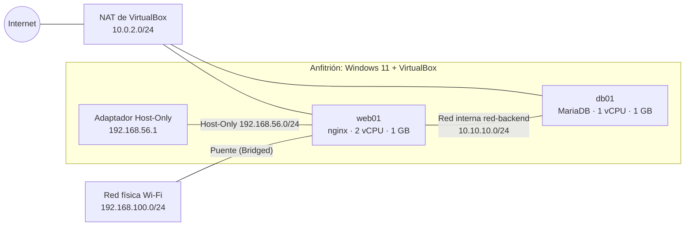

# Tarea 5.2 — Despliegue de entorno virtualizado y gestión de redes virtuales

**Materia:** Administración de Servidores · **Unidad 5: Virtualización**
**Alumno:** Josué Javier Álvarez Valle · ITS Monclova
**Laboratorio:** Windows 11 Home + VirtualBox 7.2.20 + Vagrant 2.4.9 · Intel Core i3-1115G4 · 7.7 GB RAM

Esta práctica despliega, con un solo comando (`vagrant up`), **dos servidores virtuales** conectados con los cuatro modos de red de VirtualBox: **NAT, Solo anfitrión (Host-Only), Red interna y Puente (Bridged)**. Después se prueba qué se puede alcanzar y qué queda aislado, y se configuran los recursos: vCPU y RAM ajustables, disco con **aprovisionamiento fino (thin provisioning)** y carpeta compartida entre Windows y las VMs.

| Contenido | Archivo |
|---|---|
| Definición de las VMs, redes, discos y carpeta compartida | [Vagrantfile](Vagrantfile) |
| Orquestación y pruebas (PowerShell, se ejecutan en Windows) | [scripts/](scripts/) |
| Aprovisionamiento dentro de las VMs (bash) | [scripts/guest/](scripts/guest/) |
| Salidas de las pruebas | [evidencias/](evidencias/) |
| Carpeta compartida con las VMs | [compartido/](compartido/) |

---

## 1. Diseño de la red virtual



### Adaptadores de cada máquina

| VM | Adaptador | Modo | Red | IP | Para qué sirve |
|---|---|---|---|---|---|
| **web01** | 1 | **NAT** | 10.0.2.0/24 | 10.0.2.15 | Salida a internet y reenvío del puerto `8088` (Windows) → `80` (web01) |
| web01 | 2 | **Solo anfitrión** | 192.168.56.0/24 | 192.168.56.10 | Windows administra y abre el sitio |
| web01 | 3 | **Red interna** `red-backend` | 10.10.10.0/24 | 10.10.10.10 | Segmento privado hacia la base de datos |
| web01 | 4 | **Puente** (Wi-Fi) | Red física (DHCP) | la asigna el router | Integración directa a la red de la empresa |
| **db01** | 1 | **NAT** | 10.0.2.0/24 | 10.0.2.15 | Solo para que Vagrant la administre |
| db01 | 2 | **Red interna** `red-backend` | 10.10.10.0/24 | 10.10.10.20 | Única red de trabajo de la base de datos |

### Qué se espera alcanzar y qué no

| Origen | Destino | ¿Debe funcionar? | Por qué |
|---|---|:---:|---|
| Windows | `http://127.0.0.1:8088` | ✅ | Reenvío de puertos del NAT (si el puerto está ocupado, `vagrant port web01` dice cuál quedó) |
| Windows | web01 `192.168.56.10` | ✅ | Red Host-Only |
| Windows | web01 por la IP del puente | ✅ | Está en la misma red física |
| Otro equipo de la LAN | web01 por la IP del puente | ✅ | El puente lo deja en la red física |
| web01 | db01 `10.10.10.20` | ✅ | Misma red interna |
| web01 | internet | ✅ | NAT |
| **Windows** | **db01 `10.10.10.20`** | ❌ | La red interna no existe en Windows |
| **Windows** | **puerto 3306 de db01 o de web01** | ❌ | MariaDB solo escucha en `10.10.10.20` |
| **LAN física** | **db01** | ❌ | db01 no tiene adaptador puente |
| db01 (con el NAT desconectado) | internet | ❌ | Aislamiento total: ver sección 4 |

> **Aclaración sobre el NAT:** una VM en modo NAT puede salir a internet y alcanzar lo mismo que el anfitrión (por ejemplo, otras VMs en Host-Only). Por eso **db01 no queda realmente aislada de salida mientras su adaptador NAT esté conectado**. El script `03_aislar_backend.ps1` desconecta ese adaptador para demostrar el aislamiento total.

---

## 2. Recursos físicos compartidos

| Recurso | Cómo se configura | Dónde |
|---|---|---|
| **vCPU y RAM** | Valores iniciales en el `Vagrantfile` (web01: 2 vCPU y 1024 MB; db01: 1 vCPU y 1024 MB), que se pueden cambiar con las variables `WEB_CPUS`, `WEB_MEM`, `DB_CPUS` y `DB_MEM` | [Vagrantfile](Vagrantfile) |
| **Ajuste en caliente** | Límite de CPU (`cpuexecutioncap`) sin apagar la VM. La RAM se cambia con reinicio (ver los límites del laboratorio, sección 6) | [01_recursos_dinamicos.ps1](scripts/01_recursos_dinamicos.ps1) |
| **Ajuste con reinicio** | Nuevo número de vCPU y de MB de RAM con `vagrant reload` | [01_recursos_dinamicos.ps1](scripts/01_recursos_dinamicos.ps1) |
| **Disco con aprovisionamiento fino** | Un disco extra de **20 GB** por VM (`config.vm.disk`), formato dinámico: en Windows ocupa solo lo que se escribe | [02_disco_fino.ps1](scripts/02_disco_fino.ps1) · [disco_fino.sh](scripts/guest/disco_fino.sh) |
| **Carpeta compartida** | `.\compartido` en Windows ↔ `/compartido` en web01 y db01 (Guest Additions) | [Vagrantfile](Vagrantfile) |

---

## 3. Estructura

```
Unidad_5/Tarea_5.2/
├── README.md
├── Vagrantfile                      # VMs, redes, discos y carpeta compartida
├── compartido/                      # carpeta compartida con las VMs (/compartido)
├── scripts/
│   ├── lib/comun.ps1                # variables y funciones comunes
│   ├── 00_ejecutar_todo.ps1         # revisa requisitos y ejecuta vagrant up
│   ├── 01_recursos_dinamicos.ps1    # vCPU y RAM (en caliente y con reinicio)
│   ├── 02_disco_fino.ps1            # capacidad contra espacio real del disco
│   ├── 03_aislar_backend.ps1        # desconecta el NAT de db01
│   ├── 04_ver_adaptadores.ps1       # adaptadores de red de las VMs vistos desde VirtualBox
│   ├── 98_revertir.ps1              # borra las VMs y sus discos
│   ├── 99_validar.ps1               # pruebas [PASA]/[FALLA] con evidencia
│   └── guest/                       # se ejecutan dentro de las VMs
│       ├── disco_fino.sh
│       ├── aprovisionar_web.sh
│       └── aprovisionar_db.sh
├── evidencias/                      # salidas de 99_validar.ps1
└── docs/                            # reporte
```

---

## 4. Uso

Todos los comandos se escriben en PowerShell, dentro de la carpeta `Unidad_5\Tarea_5.2`.

**Requisitos:** VirtualBox 7.2.x y Vagrant instalados. Para instalar Vagrant: `winget install Hashicorp.Vagrant` y abrir una terminal nueva. **Apaga las demás VMs de VirtualBox**: la laptop tiene 7.7 GB de RAM.

| Paso | Comando | Qué hace |
|---|---|---|
| 1 | `powershell -ExecutionPolicy Bypass -File .\scripts\00_ejecutar_todo.ps1` | Crea las dos VMs, las redes, los discos y la carpeta compartida. La primera vez descarga la imagen `bento/ubuntu-24.04` (≈ 600 MB). |
| 2 | `powershell -ExecutionPolicy Bypass -File .\scripts\99_validar.ps1` | Ejecuta todas las pruebas y guarda la evidencia. |
| 3 | `powershell -ExecutionPolicy Bypass -File .\scripts\01_recursos_dinamicos.ps1 -Limite 50` | Limita la CPU de web01 al 50 % sin apagarla. `-Restaurar` la devuelve a lo normal. Con `-Cpus 1 -Memoria 1280` cambia el tamaño de la VM (se reinicia). |
| 4 | `powershell -ExecutionPolicy Bypass -File .\scripts\02_disco_fino.ps1 -Llenar 500` | Escribe 500 MB en web01 y muestra cuánto crece el disco en Windows. |
| 5 | `powershell -ExecutionPolicy Bypass -File .\scripts\03_aislar_backend.ps1 -Modo Aislar` | Desconecta el NAT de db01 para dejarla solo en la red interna. `-Modo Restaurar` la reconecta. |
| 6 | `powershell -ExecutionPolicy Bypass -File .\scripts\04_ver_adaptadores.ps1` | Muestra, para cada VM, el modo de cada adaptador (NAT, Solo anfitrión, Red interna, Puente), su red, su MAC y el reenvío de puertos. |
| 7 | `powershell -ExecutionPolicy Bypass -File .\scripts\98_revertir.ps1 -Si` | Borra todo el entorno. |

**Entrar a una VM:** `vagrant ssh web01` o `vagrant ssh db01`. Dentro de las VMs hay dos comandos cortos: `ver_redes` (interfaces y rutas) y, solo en web01, `probar_db` (consulta la base de datos de db01).

**Si el puente falla:** el nombre del adaptador Wi-Fi debe ser exacto. Se consulta con `VBoxManage list bridgedifs` y se usa con `-Bridge "nombre"` en el paso 1. Algunas redes (escuelas, hoteles) no permiten varias direcciones MAC por conexión Wi-Fi y no entregan IP a la VM.

---

## 5. Pruebas de verificación

`99_validar.ps1` ejecuta estas pruebas y termina con **`Pruebas que fallaron: 0`**:

| # | Sección | Qué comprueba |
|---|---|---|
| 1 | Estado | Las dos VMs están encendidas |
| 2 | NAT | `127.0.0.1:8088` responde web01 · web01 sale a internet · la ruta por defecto es `10.0.2.2` |
| 3 | Host-Only | Windows hace ping y abre `http://192.168.56.10` |
| 4 | Red interna | web01 hace ping a db01 y consulta MariaDB · traza de un solo salto |
| 5 | Aislamiento | Windows **no** alcanza a db01 ni al puerto 3306 · MariaDB solo escucha en `10.10.10.20` · db01 no tiene Host-Only ni puente |
| 6 | Puente | web01 tiene IP de la red física y alcanza el router · Windows abre web01 por esa IP |
| 7 | Trazas | `tracert` y `traceroute`: un salto hacia web01 y primer salto `10.0.2.2` hacia internet |
| 8 | Recursos | vCPU y RAM de cada VM · discos de 20 GB que ocupan mucho menos en Windows |
| 9 | Carpeta compartida | Un archivo creado en Windows lo leen web01 y db01, y otro creado en web01 lo ve Windows |

---

## 6. Límites del laboratorio

- **Un solo hipervisor.** El enunciado pide "al menos dos entornos": aquí son dos servidores (frontend y backend) en dos segmentos de red distintos, ambos sobre VirtualBox. KVM con aceleración no es posible dentro de las VMs porque no hay virtualización anidada (se comprobó en la [Tarea 5.1](../Tarea_5.1/)), y Hyper-V como rol administrable no existe en Windows 11 Home.
- **VirtualBox corre sobre Hyper-V (modo NEM)** por la seguridad basada en virtualización de Windows, así que las VMs son algo más lentas que con VT-x directo.
- **Sin globo de memoria (ballooning).** Se probó `VBoxManage controlvm ... guestmemoryballoon` y, con VirtualBox corriendo sobre Hyper-V (modo NEM), la VM se degradó: el SSH devolvía bytes en cero y la VM llegó a colgarse. Con el límite de CPU y con el cambio de tamaño con reinicio no hubo problemas. Por eso la RAM se ajusta con `vagrant reload` y no en caliente.
- **Disco dinámico:** crece al escribir, pero no se encoge solo al borrar archivos. Hay que compactarlo con `VBoxManage modifymedium --compact`.
- **Contraseñas de prueba:** el usuario `web` de la base de datos usa una contraseña de laboratorio escrita en `aprovisionar_db.sh`. No debe usarse así en producción.
