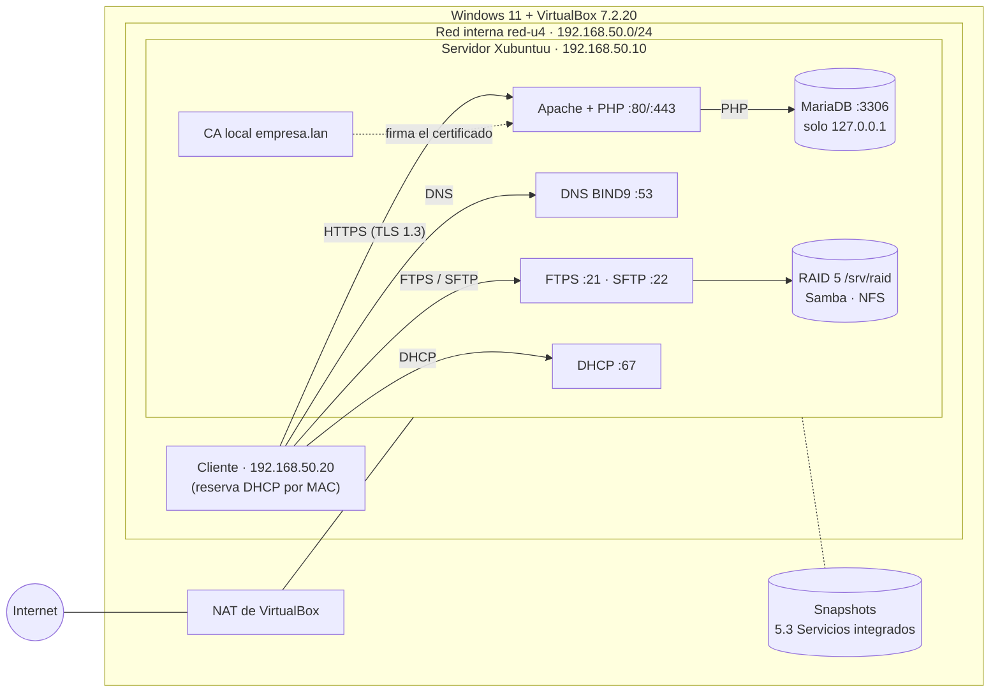

# Tarea 5.3 — Proyecto integrador: virtualización de servicios y migración de infraestructura

**Materia:** Administración de Servidores · **Unidad 5: Virtualización**
**Alumno:** Josué Javier Álvarez Valle · ITS Monclova
**Laboratorio:** Windows 11 Home + VirtualBox 7.2.20 · Intel Core i3-1115G4 · 7.7 GB de RAM

Este proyecto integra en un ambiente virtualizado los servicios esenciales construidos durante el curso, en una topología **cliente/servidor segura**: **DNS, DHCP, web HTTPS, base de datos y almacenamiento**. Además:

- Protege el estado del servidor con un **snapshot en caliente** (disco y memoria).
- Provoca un **fallo de configuración controlado** y se **recupera** restaurando ese snapshot.
- Documenta la **infraestructura como código** para reconstruirlo todo desde cero.

| Contenido | Archivo |
|---|---|
| Esta guía: arquitectura, inventario, uso y contingencia | este README |
| Manual de reconstrucción paso a paso | [docs/manual_reconstruccion.md](docs/manual_reconstruccion.md) |
| Scripts (Windows, servidor, cliente e infraestructura como código) | [scripts/](scripts/) |
| Salidas de las pruebas | [evidencias/](evidencias/) |

---

## 1. Arquitectura de la red virtualizada

El cliente **no tiene salida directa a internet**: solo está en `red-u4`, y todo lo que necesita (dirección IP, nombres, páginas web, archivos) lo recibe del servidor. El servidor tiene dos adaptadores: `enp0s3` en NAT (salida a internet) y `enp0s8` en `red-u4` con la IP fija `192.168.50.10`.

## 2. Inventario de servicios

| Servicio | Programa | Puerto | Seguridad aplicada | Tarea de origen |
|---|---|---|---|---|
| **DHCP** | isc-dhcp-server | 67/udp | Rango acotado, exclusiones y reserva por MAC | 4.1 |
| **DNS** | BIND9 (`named`) | 53 | Zonas `empresa.lan` directa e inversa · consultas solo de la red interna | 4.1 |
| **Web HTTPS** | Apache 2.4 + PHP 8 | 80, 443 | TLS 1.2/1.3, CA local, HTTP redirige a HTTPS, intranet solo para la LAN | 4.2 |
| **Base de datos** | MariaDB | 3306 | Solo `127.0.0.1` · usuario de la aplicación con permiso SELECT | 4.2 |
| **Almacenamiento (archivos)** | vsftpd (FTPS) · OpenSSH (SFTP) | 21, 22 | Sin acceso anónimo · TLS obligatorio · usuarios enjaulados (chroot) | 4.2 |
| **Almacenamiento (discos)** | mdadm RAID 5 · Samba · NFS | — | Redundancia de 1 disco · permisos por grupo | 3.3 |
| Correo (extra) | Postfix · Dovecot | 25, 587, 993 | TLS obligatorio · buzones virtuales | 4.3 |
| Usuarios, cuotas y respaldos (apoyo) | sudoers · quota · cron | — | Roles, horarios, bloqueo por intentos y respaldos automáticos | 3.1 y 3.2 |

## 3. Infraestructura como código

Todo se puede crear y reconstruir con scripts, sin pasos manuales (salvo instalar el sistema operativo):

| Script | Dónde | Qué hace |
|---|---|---|
| [`scripts/iac/crear_vms.ps1`](scripts/iac/crear_vms.ps1) | Windows | Crea las dos VMs con el mismo hardware que el laboratorio: 2 vCPU, NAT + red interna, 6 discos dinámicos y la MAC reservada del cliente |
| [`scripts/iac/reconstruir_servidor.sh`](scripts/iac/reconstruir_servidor.sh) | Servidor | Clona los repositorios de las unidades 3 y 4 y ejecuta en orden sus scripts: usuarios, discos, RAID, DHCP/DNS, web HTTPS, MariaDB, FTPS/SFTP y correo. Opciones: `--simular`, `--si`, `--sin-u3` |

El procedimiento completo está en el [manual de reconstrucción](docs/manual_reconstruccion.md).

## 4. Scripts de la tarea

| Script | Dónde se ejecuta | Qué hace |
|---|---|---|
| [`00_estado.ps1`](scripts/00_estado.ps1) | Windows | Estado de las VMs, sus redes, sus snapshots y la RAM del anfitrión (solo lee) |
| [`01_crear_snapshot.ps1`](scripts/01_crear_snapshot.ps1) | Windows | **Snapshot en caliente** del servidor: guarda disco y memoria |
| [`02_restaurar_snapshot.ps1`](scripts/02_restaurar_snapshot.ps1) | Windows | **Restauración**: apaga la VM, restaura el snapshot y la enciende ya con los servicios funcionando; mide el tiempo |
| [`99_validar.ps1`](scripts/99_validar.ps1) | Windows | Pruebas `[PASA]/[FALLA]` de las VMs, la red, los discos, el snapshot y los scripts |
| [`servidor/01_validar_servicios.sh`](scripts/servidor/01_validar_servicios.sh) | Servidor | Inventario y validación de todos los servicios. Con `--completa` suma los `99_validar.sh` de las tareas 3.3, 4.1, 4.2 y 4.3 |
| [`servidor/02_fallo_controlado.sh`](scripts/servidor/02_fallo_controlado.sh) | Servidor | Provoca un fallo de configuración: `web`, `dns` o `ambos`; `estado` y `revertir` |
| [`servidor/03_rendimiento.sh`](scripts/servidor/03_rendimiento.sh) | Servidor | Mide CPU, memoria, disco y red mientras recibe carga |
| [`cliente/prueba_integral.sh`](scripts/cliente/prueba_integral.sh) | Cliente | Recorrido de DHCP, DNS, HTTPS, base de datos, FTPS/SFTP y correo, con el paso de tráfico entre servicios |
| [`cliente/prueba_rendimiento.sh`](scripts/cliente/prueba_rendimiento.sh) | Cliente | Genera carga HTTPS y mide latencia y peticiones por segundo |

## 5. Uso

**Preparación:** apaga las demás VMs de VirtualBox (la RAM alcanza para dos máquinas) y enciende **primero el servidor** y después el cliente. Los comandos de Windows se escriben en PowerShell dentro de la carpeta `Unidad_5\Tarea_5.3`; los de Linux, en la terminal de la VM indicada.

### 5.1 Validar que todo funciona

| Dónde | Comando |
|---|---|
| Servidor | `sudo bash /home/vboxuser/Virtualizacion-Servidores/Unidad_5/Tarea_5.3/scripts/servidor/01_validar_servicios.sh` |
| Cliente | `bash /home/vboxuser/Virtualizacion-Servidores/Unidad_5/Tarea_5.3/scripts/cliente/prueba_integral.sh` |
| Windows | `powershell -ExecutionPolicy Bypass -File .\scripts\00_estado.ps1` |

### 5.2 Procedimiento de contingencia (snapshot, fallo y restauración)

| Paso | Dónde | Comando | Resultado esperado |
|---|---|---|---|
| 1 | Windows | `powershell -ExecutionPolicy Bypass -File .\scripts\01_crear_snapshot.ps1` | Snapshot **`5.3 Servicios integrados`** creado con el servidor encendido (guarda también la memoria) |
| 2 | Servidor | `sudo bash .../scripts/servidor/02_fallo_controlado.sh web` | Se cambia la ruta del certificado y **Apache ya no arranca**: el HTTPS queda caído |
| 3 | Cliente | `bash .../scripts/cliente/prueba_integral.sh` | Aparecen `[FALLA]` en la parte web: el fallo es real |
| 4 | Windows | `powershell -ExecutionPolicy Bypass -File .\scripts\02_restaurar_snapshot.ps1` | La VM se apaga, vuelve al snapshot y se enciende ya funcionando; muestra el **tiempo de recuperación** |
| 5 | Cliente | `bash .../scripts/cliente/prueba_integral.sh` | **0 fallas**: el servicio quedó como antes del fallo |

> **Importante:** restaurar un snapshot descarta todo lo que se haya hecho en el servidor *después* de crearlo. Por eso las evidencias del servidor (`01_validar_servicios.sh`) se generan **antes** del snapshot.

### 5.3 Medir el desempeño

En el **servidor** se mide durante 40 segundos y, mientras tanto, en el **cliente** se genera la carga:

| Dónde | Comando |
|---|---|
| Servidor | `sudo bash .../scripts/servidor/03_rendimiento.sh 40` |
| Cliente | `bash .../scripts/cliente/prueba_rendimiento.sh 600 10` |

El cliente envía 600 peticiones HTTPS con 10 en paralelo a una página que usa Apache, PHP y MariaDB. El servidor informa el uso de CPU, memoria, disco y red; el cliente, las peticiones por segundo y la latencia (promedio, mediana, p95 y máxima).

## 6. Seguridad de la topología

- **Segmentación:** el cliente solo existe en la red interna; el servidor es la única puerta hacia internet (NAT).
- **Cifrado de extremo a extremo:** HTTPS con una CA propia (TLS 1.2/1.3), FTPS con TLS obligatorio y SFTP sobre SSH; ningún servicio entrega contraseñas en claro.
- **Superficie mínima:** MariaDB escucha solo en `127.0.0.1`, el FTP no admite usuarios anónimos y los usuarios de archivos están enjaulados.
- **Recuperación:** snapshots del servidor, RAID 5 y respaldos automáticos protegen ante fallos de configuración y de disco.

## 7. Límites del laboratorio

- **Restaurar es destructivo:** descarta los cambios posteriores al snapshot (es lo que se busca ante un fallo, pero hay que tenerlo presente).
- **Los snapshots en caliente ocupan espacio:** guardan hasta toda la RAM de la VM (≈ 3.7 GB para el servidor).
- **El servidor tiene snapshots anteriores** (`3.1 terminada`, `3.2 terminada`, `3.3 lista` y la base del clon enlazado del cliente): no deben borrarse, porque el `Cliente-U4` depende de ellos.
- **No se exporta un OVA:** se eligió documentar la infraestructura como código, que es más ligera (el disco del servidor ocupa más de 14 GB) y se puede subir a git.
- **La reconstrucción encadenada** (`reconstruir_servidor.sh`) reutiliza scripts ya probados uno por uno; su ejecución completa sobre una VM nueva no se repitió de principio a fin. Su plan (`--simular`), la creación de VMs y los snapshots sí se probaron.
